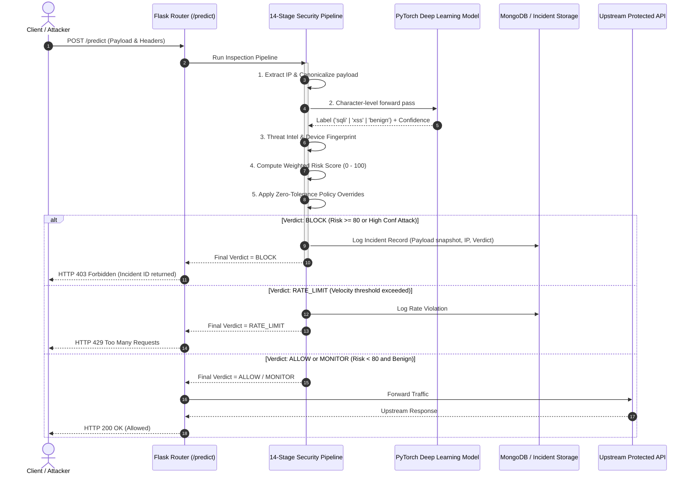

# 🛡️ End-to-End API Request Lifecycle & Detection Flowchart

An architectural overview and visual flowchart documenting how incoming API requests are ingested, traced, inspected, scored, and ultimately **Allowed** or **Rejected** by the **Adaptive Security Gateway**.

---

## 📊 Complete System Flowchart

The following flowchart illustrates the entire decision tree across all 14 inspection stages:

```mermaid
flowchart TD
    %% Styling Definitions
    classDef clientNode fill:#1e293b,stroke:#64748b,stroke-width:2px,color:#f8fafc;
    classDef stageNode fill:#0f172a,stroke:#38bdf8,stroke-width:2px,color:#f8fafc;
    classDef decisionNode fill:#312e81,stroke:#818cf8,stroke-width:2px,color:#ffffff;
    classDef allowNode fill:#064e3b,stroke:#10b981,stroke-width:2px,color:#a7f3d0;
    classDef blockNode fill:#7f1d1d,stroke:#ef4444,stroke-width:2px,color:#fecaca;
    classDef rateNode fill:#78350f,stroke:#f59e0b,stroke-width:2px,color:#fef3c7;

    %% 1. Ingress
    A["🌐 Incoming HTTP Request<br/>(Client / Attacker)"]:::clientNode
    A --> B["Stage 1: Ingress & JSON Validation<br/>Start latency timer (time.perf_counter)"]:::stageNode

    B --> C{"Valid JSON?"}:::decisionNode
    C -- "No" --> R400["❌ HTTP 400 Bad Request<br/>Invalid / Missing JSON"]:::blockNode
    C -- "Yes" --> D["Stage 2: Parser & Extractor<br/>Resolve Client IP (X-Forwarded-For)<br/>Extract Params, Headers, Body, Cookies"]:::stageNode

    %% 2. Cleaning & Parallel Feature Extraction
    D --> E["Stage 3: Preprocessor & Canonicalizer<br/>1. Strip Null Bytes & Control Chars<br/>2. Recursive URL Decode (%2527 -> ')<br/>3. Recursive HTML Unescape (&lt; -> <)<br/>4. Whitespace Normalization"]:::stageNode

    subgraph FeatureEng ["🔬 Parallel Feature Extraction & Intelligence Enrichment"]
        E --> F["Stage 4: ML Deep Learning Detection<br/>Character Vocab Tokenization<br/>PyTorch Forward Pass (Softmax)<br/>Heuristic Signature Fallback"]:::stageNode
        D --> G["Stage 5: Threat Intelligence<br/>Offline CIDR Lookup<br/>Tor Exit Node, C2, Scanner Check<br/>Reputation Score (0-100)"]:::stageNode
        D --> H["Stage 6-7: Profiler & Session State<br/>SHA256 Device Fingerprint<br/>Scanner Pattern Check (sqlmap, nikto)<br/>Sliding Window Velocity (10s / 60s)"]:::stageNode
    end

    %% 3. Behavioral Analysis
    H --> I["Stage 8: Behavioral Engine<br/>Scan tool penalties (+45)<br/>Burst velocity penalties (>20 req/10s)<br/>Sensitive path probing (/.env, /admin)"]:::stageNode

    %% 4. Multi-Factor Risk Fusion
    F --> J["Stage 9: Dynamic Risk Engine<br/>Risk = (ML * 0.70) + (ThreatIntel * 0.15) + (Behavior * 0.15)<br/>Score bounded between 0.0 - 100.0"]:::stageNode
    G --> J
    I --> J

    %% 5. Decision Engine
    J --> K["Stage 10: Decision Engine<br/>Threshold Evaluation"]:::stageNode
    K --> L{"Risk Score Assessment"}:::decisionNode
    L -- "Risk < 40" --> M1["Preliminary: ALLOW"]:::stageNode
    L -- "40 <= Risk < 80" --> M2["Preliminary: MONITOR"]:::stageNode
    L -- "Risk >= 80" --> M3["Preliminary: BLOCK"]:::stageNode

    %% 6. Policy Enforcement
    M1 --> N["Stage 11: Policy Engine<br/>Deterministic Zero-Tolerance Overrides"]:::stageNode
    M2 --> N
    M3 --> N

    N --> P1{"Analyst Whitelist Override?"}:::decisionNode
    P1 -- "Yes" --> ACT_ALLOW["✅ Force ALLOW (Rule 1)"]:::allowNode
    P1 -- "No" --> P2{"Analyst Blacklist Override?"}:::decisionNode
    
    P2 -- "Yes" --> ACT_BLOCK["⛔ Force BLOCK (Rule 2)"]:::blockNode
    P2 -- "No" --> P3{"Rate Limit Exceeded?"}:::decisionNode

    P3 -- "Yes" --> ACT_RATE["⏳ Force RATE_LIMIT (Rule 3)"]:::rateNode
    P3 -- "No" --> P4{"ML SQLi/XSS Confidence >= 90%?"}:::decisionNode

    P4 -- "Yes" --> ACT_BLOCK
    P4 -- "No" --> P5{"Scanner + Attack Vector Present?"}:::decisionNode

    P5 -- "Yes" --> ACT_BLOCK
    P5 -- "No" --> P6{"Malicious IP + Attack Vector?"}:::decisionNode

    P6 -- "Yes" --> ACT_BLOCK
    P6 -- "No" --> P7{"Evaluate Preliminary Verdict"}:::decisionNode

    P7 -- "BLOCK" --> ACT_BLOCK
    P7 -- "RATE_LIMIT" --> ACT_RATE
    P7 -- "MONITOR" --> ACT_MONITOR["👁️ MONITOR (Elevated Risk)"]:::stageNode
    P7 -- "ALLOW" --> ACT_ALLOW

    %% 7. Actions & Outgoing Responses
    ACT_BLOCK --> Q1["Stage 12: Incident & State Mutator<br/>1. Log Incident in MongoDB / Memory<br/>2. Increment Session Violations<br/>3. Compute Latency & Telemetry"]:::blockNode
    Q1 --> RESP_403["🚫 HTTP 403 Forbidden<br/>(Request Rejected at Edge)"]:::blockNode

    ACT_RATE --> Q2["Stage 12: Rate Violations Logged<br/>Record penalty against session"]:::rateNode
    Q2 --> RESP_429["⚠️ HTTP 429 Too Many Requests<br/>(Request Rejected)"]:::rateNode

    ACT_MONITOR --> Q3["Stage 13-14: Log Observability Event<br/>Allow Request with Monitoring Tag"]:::stageNode
    Q3 --> RESP_200["✅ HTTP 200 OK<br/>Forwarded to Upstream API"]:::allowNode

    ACT_ALLOW --> RESP_200
```



---

## 🔄 Interaction Sequence Diagram



---

## 📋 Stage-by-Stage Reference Guide

| Stage | Name | Key Function / Module | Purpose & Logic |
| :---: | :--- | :--- | :--- |
| **1** | **Ingress** | [`gateway/routes/predict_routes.py`](file:///c:/Users/saich/Desktop/sqli-xss-ml-detector/gateway/routes/predict_routes.py) | Ingests HTTP POST request, validates JSON body structure, and begins latency benchmarking. |
| **2** | **Parser & Extractor** | [`gateway/pipeline/parser.py`](file:///c:/Users/saich/Desktop/sqli-xss-ml-detector/gateway/pipeline/parser.py) | Unpacks nested JSON, headers, queries, and cookies. Extracts client IP via proxy awareness (`X-Forwarded-For`). |
| **3** | **Preprocessor** | [`gateway/pipeline/preprocess.py`](file:///c:/Users/saich/Desktop/sqli-xss-ml-detector/gateway/pipeline/preprocess.py) | Strips null bytes (`%00`, `\x00`), recursively unescapes HTML entities and URL hex encodings (`%2527` $\rightarrow$ `'`). |
| **4** | **ML Detection** | [`gateway/pipeline/detection.py`](file:///c:/Users/saich/Desktop/sqli-xss-ml-detector/gateway/pipeline/detection.py) | Tokenizes payload against character vocabulary; PyTorch forward pass outputs Softmax probabilities for `benign`, `sqli`, `xss`. Employs fail-closed fallback. |
| **5** | **Threat Intelligence** | [`gateway/pipeline/threat_intel.py`](file:///c:/Users/saich/Desktop/sqli-xss-ml-detector/gateway/pipeline/threat_intel.py) | Sub-millisecond offline lookup matching IP against Tor exit nodes, botnet C2 servers, and known attacker CIDRs. |
| **6** | **Device Profiler** | [`gateway/pipeline/device_profiler.py`](file:///c:/Users/saich/Desktop/sqli-xss-ml-detector/gateway/pipeline/device_profiler.py) | Generates SHA-256 fingerprint hash and scans `User-Agent` for scanners (`sqlmap`, `nikto`, `burp`) or CLI clients (`curl`, `requests`). |
| **7** | **Session Manager** | [`gateway/pipeline/session_manager.py`](file:///c:/Users/saich/Desktop/sqli-xss-ml-detector/gateway/pipeline/session_manager.py) | Sliding-window request counter tracking 10-second burst rates, 60-second velocity, and historical violation counts. |
| **8** | **Behavior Engine** | [`gateway/pipeline/behavior_engine.py`](file:///c:/Users/saich/Desktop/sqli-xss-ml-detector/gateway/pipeline/behavior_engine.py) | Penalizes burst rates, sensitive path enumeration (e.g. `/.env`, `/admin`, `/wp-admin`), and repetitive violations. |
| **9** | **Risk Engine** | [`gateway/pipeline/risk_engine.py`](file:///c:/Users/saich/Desktop/sqli-xss-ml-detector/gateway/pipeline/risk_engine.py) | Blends signals into a single score: `Risk = (ML * 0.70) + (ThreatIntel * 0.15) + (Behavior * 0.15)`. |
| **10** | **Decision Engine** | [`gateway/pipeline/decision_engine.py`](file:///c:/Users/saich/Desktop/sqli-xss-ml-detector/gateway/pipeline/decision_engine.py) | Maps risk score to preliminary baseline verdicts: `< 40` (ALLOW), `40 - 79` (MONITOR), `≥ 80` (BLOCK). |
| **11** | **Policy Engine** | [`gateway/pipeline/policy_engine.py`](file:///c:/Users/saich/Desktop/sqli-xss-ml-detector/gateway/pipeline/policy_engine.py) | Applies zero-tolerance overrides (Analyst Whitelist/Blacklist, ML Confidence $\ge 90\%$, Scanner + Exploit). |
| **12** | **Incident Service** | [`gateway/services/incident_service.py`](file:///c:/Users/saich/Desktop/sqli-xss-ml-detector/gateway/services/incident_service.py) | Persists flagged incidents into MongoDB with in-memory fallback. Increments session violation counters. |
| **13** | **Response Formatter** | [`gateway/routes/predict_routes.py`](file:///c:/Users/saich/Desktop/sqli-xss-ml-detector/gateway/routes/predict_routes.py) | Packages detailed JSON response including `verdict`, `risk_score`, `risk_level`, `confidence`, `latency_ms`, and `incident_id`. |
| **14** | **Enforcement Action** | Gateway HTTP Status Handler | Issues **HTTP 200** to forward clean traffic, **HTTP 429** for rate limits, or **HTTP 403** to drop attacks at the perimeter. |

---

## 🎯 Final Verdict Matrix

```text
               ┌────────────────────────────────────────────────────────┐
               │                   POLICY ENGINE HIERARCHY              │
               └────────────────────────────────────────────────────────┘
                                           │
             ┌─────────────────────────────┴────────────────────────────┐
             ▼                                                          ▼
  [ Analyst Whitelist ]                                      [ Analyst Blacklist ]
       │                                                          │
       ▼                                                          ▼
  HTTP 200 ALLOW                                             HTTP 403 BLOCK
                                           │
                                           ▼
                              [ Rate Limit Exceeded? ]
                                           │
                                           ▼
                                   HTTP 429 RATE_LIMIT
                                           │
                                           ▼
                           [ High-Confidence ML Attack? ]
                         (Label in {sqli, xss} and Conf >= 90%)
                                           │
                                           ▼
                                    HTTP 403 BLOCK
                                           │
                                           ▼
                             [ Scanner / Bad IP + Attack? ]
                                           │
                                           ▼
                                    HTTP 403 BLOCK
                                           │
                                           ▼
                             [ Fallback: Risk Score ]
             ┌─────────────────────────────┼────────────────────────────┐
             ▼                             ▼                            ▼
        Risk < 40                     40 <= Risk < 80               Risk >= 80
             │                             │                            │
             ▼                             ▼                            ▼
       HTTP 200 ALLOW               HTTP 200 MONITOR             HTTP 403 BLOCK
       (Forward Clean)             (Forward + Logged)           (Edge Termination)
```
